<div align="center">

# ResearchPilot

### 从研究问题，到可追溯的结论

面向 A 股公司、产业链与行业研究的 AI Agent。<br>
规划问题、核查证据、计算财务数据，让每一次研究都能继续、回看和验证。


[快速体验](#快速体验) · [功能一览](#功能一览) · [研究流程](#研究流程) · [架构](#架构) · [测试](#测试与验证) · [今日报告](docs/DAILY_2026-10-22.md)

</div>

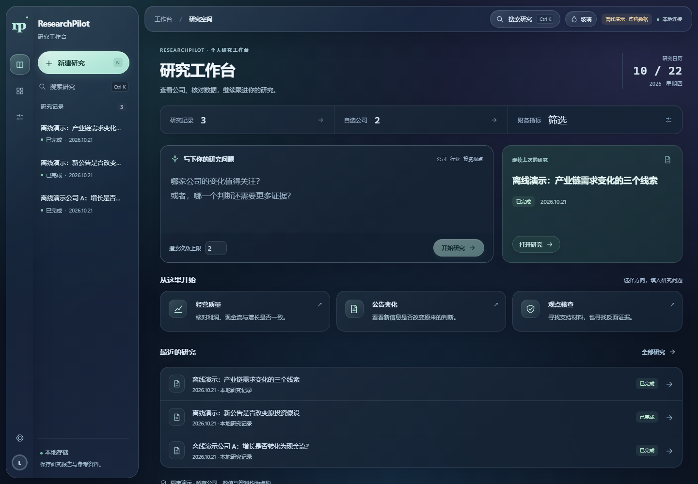

> 所有展示截图均来自隔离的虚构演示数据。当前为 v2.0 开发版本；微信原生源码已提供，仍待开发者工具编译、真机验收与 HTTPS 部署。

## 玻璃材质工作台

沿用原深色 Studio 布局，增加磨砂导航、半透明工具条、圆润控件、细高光与指针反光。报告正文保持清晰实底；右上角水滴按钮可切换实色外观，系统减少透明度或提高对比度时自动降级。

参考 Apple Liquid Glass 原则，以本地 CSS/JavaScript 实现网页材质，不新增外部运行依赖。此次更新应用于电脑 Studio 及其窄屏布局。[设计参考、截图与验收](docs/GLASS_UI_2026-10-22.md)。

## 随时查看研究

手机端将常用操作集中到研究、自选和个人空间：搜索记录、切换报告版本、点开引用、核查财务来源。新建研究使用底部面板，阅读支持目录与大字模式。

<table>
  <tr>
    <td align="center"><b>研究工作台</b></td>
    <td align="center"><b>报告阅读</b></td>
    <td align="center"><b>公司财务</b></td>
  </tr>
  <tr>
    <td>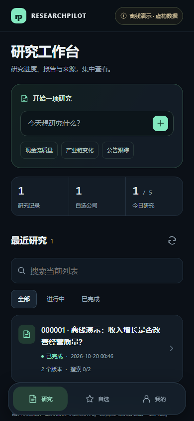</td>
    <td>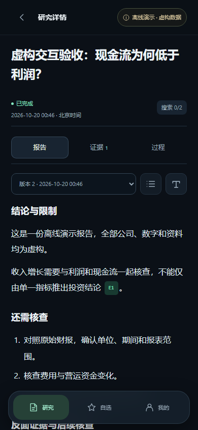</td>
    <td>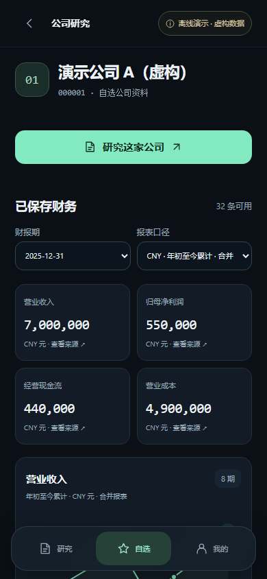</td>
  </tr>
</table>

[查看引用与来源截图](docs/assets/mobile-sources.png) · [手机界面交付记录](docs/MOBILE_UI_2026-10-20.md)

## 功能一览

| 能力 | 已实现的功能 |
| --- | --- |
| 自主研究 | 问题拆解、研究假设、证据缺口驱动检索、有界反思与补充研究 |
| 证据追溯 | 引用定位、原文摘录、来源与日期、结论—假设—证据—来源关系 |
| 报告验证 | 引用有效性、限定规则的数值/方向冲突、逐句原文匹配、Critic 待核查项 |
| 财务分析 | Python Decimal 计算同比/环比、单季度、TTM、毛利率与基础估值；保留公式和输入编号 |
| 财报研究 | 文本 PDF 候选提取与人工确认、同口径同业比较、七类财务检查、利润变化分解 |
| 持续研究 | 后台任务、暂停/恢复、研究版本、历史假设与新数据比较、报告差异 |
| 公司工作台 | 自选公司、档案、投资观点与验证条件、可重放财务筛选、默认关闭的监控 |
| 移动端基础 | 可选 FastAPI、邀请式微信登录接口、每人独立 SQLite、幂等任务、配额与并发边界 |
| 工程评测 | 离线回归、合成评测集、模型/工具轨迹、已知用量与显式价格下的费用估算 |
| 研究信号验证 | 五因子透明评分、事前档案时点检查、未来财务判据、共同样本对照、精确输入导出重放 |
| 前向研究账本 | 资料只读检查、未来判断登记、输入/规则固定、追加复盘、财报修订差异、首次与最新结果分离 |

引用存在或原文匹配，不等于一般语义和事实得到认证。财务缺失值、未知口径和费用缺失均保留为未知；不由模型补造数值。当前不提供策略回测或自动交易。

<details>
<summary><b>更多电脑端画面：报告、引用与财务</b></summary>

### 版本化报告与引用

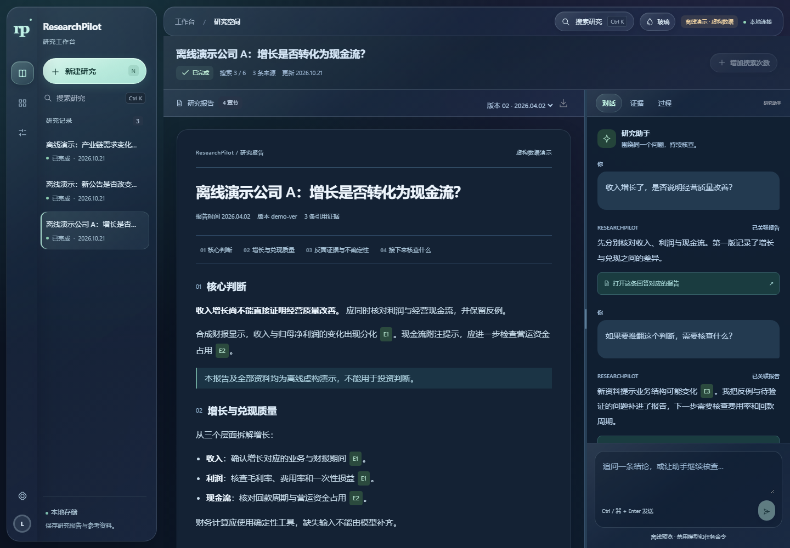

### 财务分析与数据来源

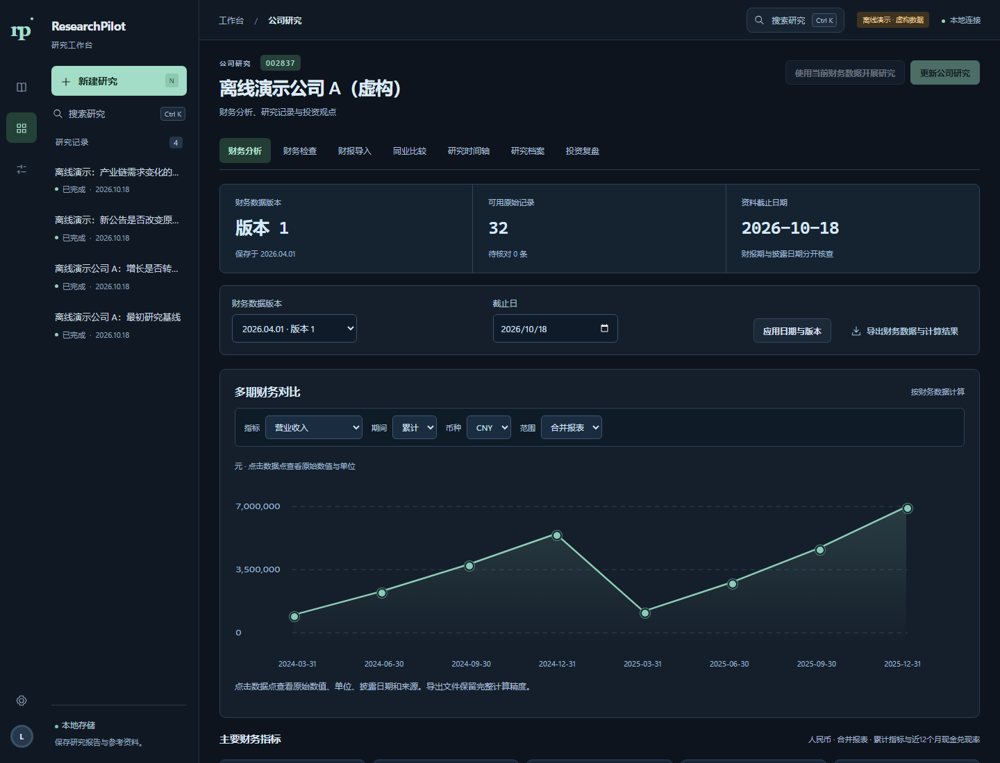

</details>

## 研究验证工具（独立页面）

电脑主界面使用 [ResearchPilot Studio](http://127.0.0.1:8528/)，保留原有深色布局、研究、自选和财务筛选导航。专项研究验证工具单独运行：

```bash
streamlit run signal_validation_app.py --global.developmentMode false --server.address 127.0.0.1 --server.port 8550 --browser.gatherUsageStats false --theme.base dark
python -m scripts.evaluate_research_signals --demo
```

打开 [本机验证页](http://127.0.0.1:8550/)。规则和数据缺失都可追溯；示例研究判断均为虚构，当前没有真实模型对照成绩或收益回测。[算法、档案格式与验收](docs/RESEARCH_SIGNALS_2026-10-20.md)。

新增“前向研究”和“数据检查”：先检查已保存财务版本，固定今天的规则、证据与可选人工判断；未来选择新财报版本追加复盘。修订前后数值直接比较，首次已知结果保留，最新结果单独查看，旧版本可下载重放。默认使用隔离虚构演示，明确保存才写入本机附加账本表，不调用外部 API。

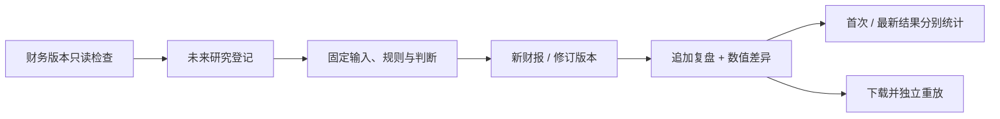

实际研究需要先导入核对过的标准财务版本。人工登记不是模型预测，本机时间与哈希也不是第三方存证。[账本使用与边界](docs/FORWARD_RESEARCH_2026-10-20.md)。

<details>
<summary>查看研究信号验证画面（虚构数据）</summary>

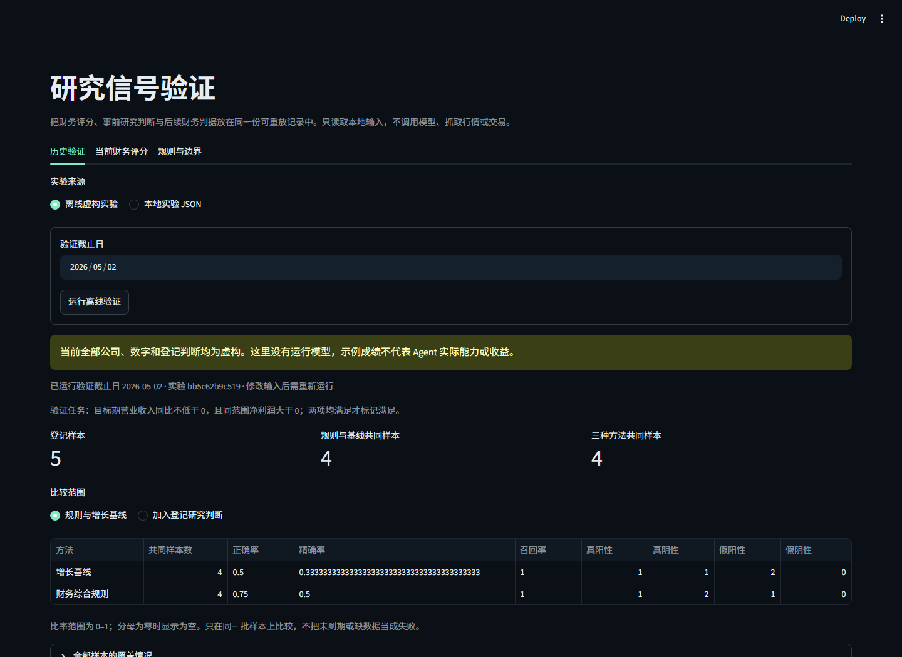

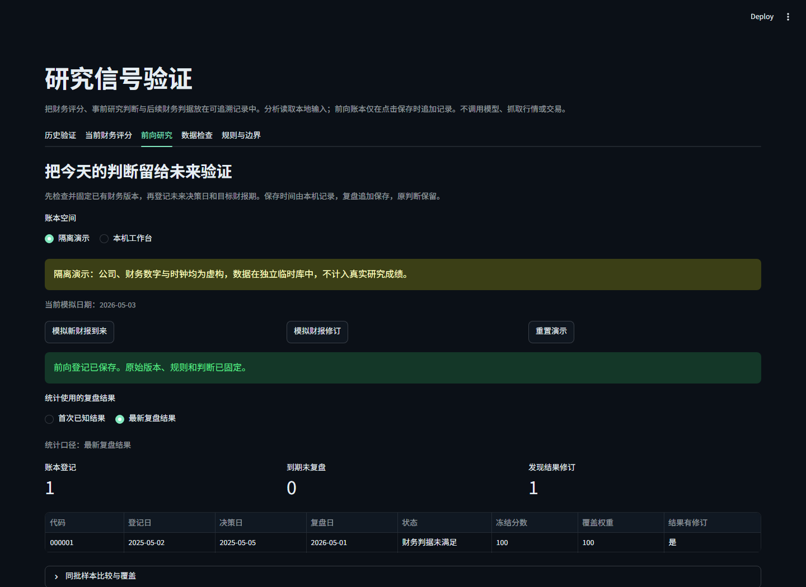

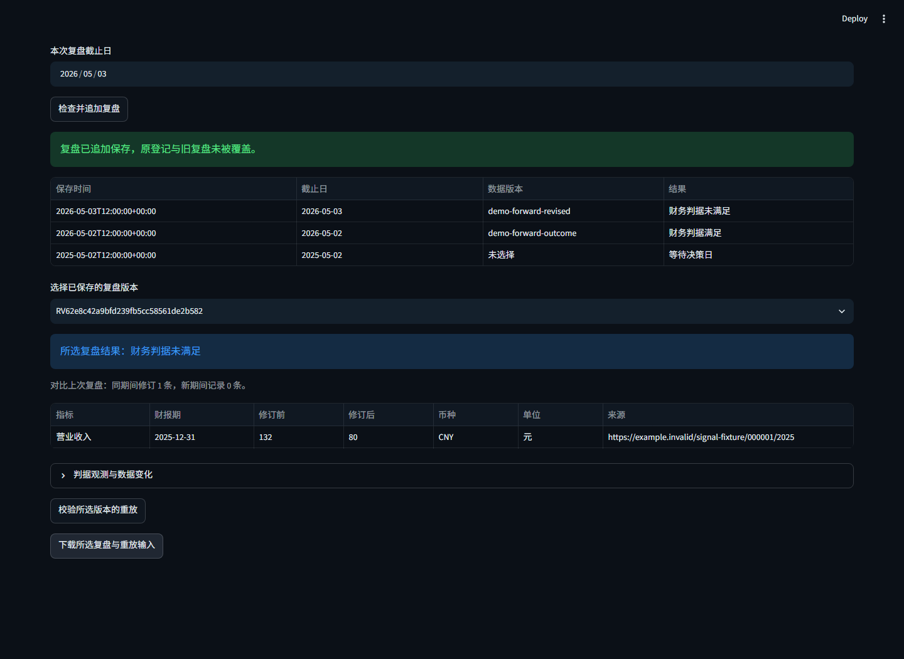

</details>

## 研究流程

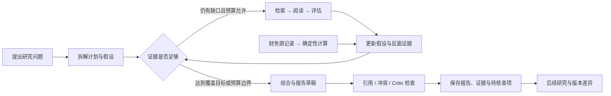

1. 写清对象与问题，例如“收入增长是否转化为经营现金流？”
2. Agent 根据证据缺口选择下一步；搜索与迭代均有上限。
3. 财务数值来自保存的源记录和 Python 运算，每个结果保留输入来源。
4. 阅读报告时检查引用、反面证据与未解决问题，再决定下一轮研究。

直接、无对立证据的规则冲突会阻断正常报告生成；一般语义、因果关系与无法匹配的结论保留待核查状态。旧版本使用当时保存的报告与证据，不回填当前来源。

## 快速体验

需要 Python 3.11。使用现有环境时可跳过虚拟环境创建。

```bash
git clone https://github.com/qche77-cloud/ResearchPilot.git
cd ResearchPilot
python -m venv .venv
```

Windows 激活：`.venv\Scripts\Activate.ps1`；macOS/Linux：`source .venv/bin/activate`。

### 手机网页演示：无需 API 密钥

```bash
python -m pip install -r requirements-miniprogram.txt
python -m scripts.serve_miniprogram --demo --port 8540
```

打开 [本机手机预览](http://127.0.0.1:8540/preview/)，选择体验 A/B。它使用临时虚构数据，不调用模型、搜索、行情或微信登录 API；正常停止服务后演示数据清除。

手机与电脑连接同一 Wi-Fi 时，可显式绑定电脑的私有 IPv4：

```bash
python -m scripts.serve_miniprogram --demo --lan-demo --host YOUR_PRIVATE_IPV4 --port 8542
```

将占位符替换为电脑 WLAN IPv4；手机访问 `http://电脑IP:8542/preview/`。电脑和服务需保持运行。默认演示只允许本机；局域网模式拒绝通配和公网绑定。这是网页体验，尚无微信小程序体验码。

[手机访问步骤](docs/MINIPROGRAM_PHONE_ACCESS_2026-10-20.md) · [原生小程序配置与限制](miniprogram/README.md)

### 电脑研究工作台

```bash
python -m pip install -r requirements.txt
streamlit run studio_app.py --server.address 127.0.0.1 --server.port 8528
```

打开 [电脑工作台](http://127.0.0.1:8528/)。原有 `agent_app.py` 与 `app.py` 继续保留。

真实研究需在本机将 `.env.example` 复制为 `.env` 后填写：

| 配置 | 用途 |
| --- | --- |
| `OPENAI_API_KEY` | 现有 OpenAI 兼容模型服务 |
| `TAVILY_API_KEY` | 真实资料检索 |
| `LLM_MODEL` | 可选，沿用项目默认模型 |

密钥只放在本地或后端环境，不放在客户端、截图或 Git 中。真实研究会产生服务商费用；搜索次数上限不是金额硬上限。移动端真实研究默认关闭，须显式配置后才能使用。

## 架构

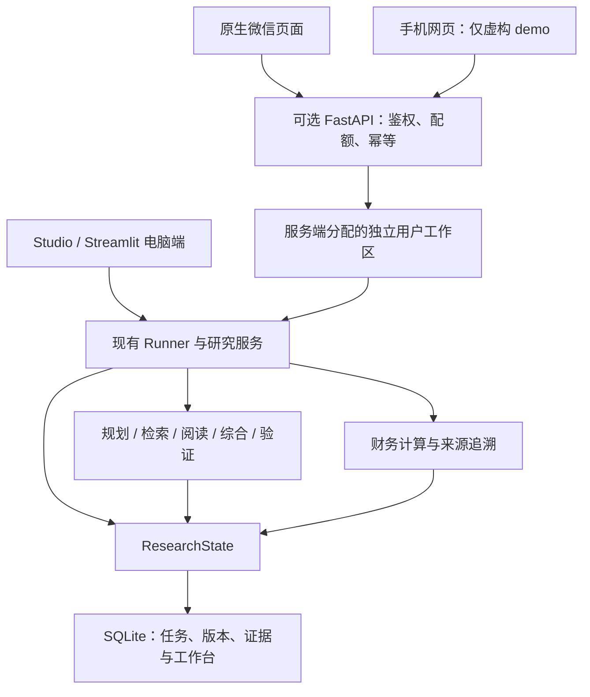

保留 Python、SQLite 和已有执行链路；逻辑角色通过可测试模块实现。手机用户工作区与桌面历史默认独立，当前没有自动同步。移动 API 按单服务进程设计，不支持多机 SQLite 调度。

```text
ResearchPilot/
├── studio_app.py              # 当前电脑端入口
├── agent_app.py / app.py      # 保留的原有入口
├── src/
│   ├── agent.py / background.py
│   ├── financial_*.py         # 计算、检查、导入与筛选
│   ├── forward_*.py           # 前向登记、追加复盘与隔离演示
│   ├── research_readiness.py  # 已保存财务版本只读检查
│   ├── research_state.py      # 状态与恢复
│   ├── studio_component/      # 电脑前端
│   └── mini/                  # 可选移动 API 与独立工作区
├── miniprogram/               # 微信原生源码
├── mobile-preview/            # 虚构手机网页演示
├── evals/                     # 合成评测集与历史财报样本
├── scripts/                   # 测试、评测与运行工具
└── docs/                      # 架构、交付报告与展示截图
```

[详细架构](docs/V2_ARCHITECTURE.md) · [技术评估](docs/V2_TECH_EVALUATION.md) · [文档索引](docs/README.md)

## 测试与验证

最近本地验收：**2026-10-22**。

| 检查 | 结果 | 证据 |
| --- | --- | --- |
| 完整离线回归，含移动 API | 39/39 套件，365 项单元测试 | [回归结果](artifacts/glass-regression-2026-10-22.json) |
| 新玻璃材质 / 原 Studio 交互 | 17 / 21 项浏览器检查通过 | [玻璃专项](artifacts/glass-ui-2026-10-22/acceptance/checks.json) · [Studio](artifacts/glass-ui-2026-10-22/studio-regression/browser-checks.json) |
| 前向账本 / 独立研究验证 / 原 Studio | 11 / 10 / 21 项浏览器检查通过 | [账本](artifacts/forward-ledger-browser/checks.json) · [独立验证](artifacts/desktop-restore-signal-browser/checks.json) · [Studio](artifacts/desktop-restore-studio-browser/browser-checks.json) |
| 原生页面控制器 | 15 项通过，使用 wx 替身 | [检查记录](artifacts/miniprogram-client-checks.json) |
| 手机网页已有流程 | 11 项通过 | [流程记录](artifacts/mobile-ui-2026-10-20/workflows/checks.json) |
| 新界面交互与适配 | 16 项通过 | [交互记录](artifacts/mobile-ui-2026-10-20/acceptance/checks.json) |

```bash
python -m scripts.run_offline_tests --mobile
node scripts/check_mini_client.cjs
# 浏览器验收需另装 playwright 并安装 Chromium
python -m scripts.check_mobile_ui
# 另行启动隔离验证页后，验收虚构前向账本
python -m scripts.check_forward_browser --url http://127.0.0.1:8550
```

离线回归阻断外网和生产数据库访问；手机交互脚本自行启动隔离虚构服务，电脑浏览器脚本需指定已启动的本机预览服务。测试覆盖身份隔离、任务幂等、报告版本、目录与引用、重试、迟到响应、原始 HTML、防溢出、前向日期、财报修订和独立重放。合成场景不能代表真实金融研究准确率。

## 当前边界与下一步

- 微信登录接口和页面源码已有离线测试；微信开发者工具编译、真实登录、手机真机和 HTTPS 部署尚待验收。
- 桌面与移动资料尚未自动同步；移动端没有财报上传、公开注册或主动通知。
- PDF 导入支持文本型文件，需人工确认；不支持扫描件 OCR。
- 财务检查与利润分解提供可核查线索，不证明业务因果，也不预测收益。
- 前向样本需要真实财务版本和后续到期结果；当前不提供真实模型优越性或投资收益成绩。
- 通用语义验证、真实服务商质量、大规模生产评测仍需推进。

[今日报告](docs/DAILY_2026-10-22.md) · [历史更新](docs/PROJECT_HISTORY.md) · [v2.0 能力与限制](docs/V2_CORE_DELIVERY.md)

---

**Private — All Rights Reserved.** 个人技术作品，未授予开源使用许可。
