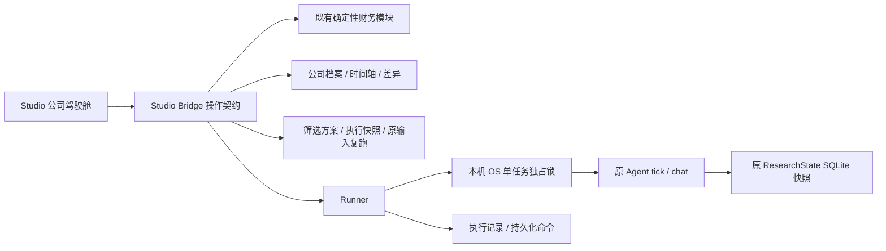

# 公司研究驾驶舱与后台可靠性完整交付记录

日期：2026-10-15。本轮承接“财务分析迁入 Studio → 公司研究档案与时间轴 → 后台可靠性 → 可保存、可重复执行的筛选方案”的授权；不新增回测、交易执行或未经验证的算法评分。

## 已实现的能力

| 工作项 | 可运行结果 |
| --- | --- |
| 财务分析迁入 Studio | 公司代码/本地名称入口，自选公司卡片；营业收入、净利润、归母净利润、经营现金流、毛利率等多期图表；累计、单季、TTM、期末及币种/范围选择 |
| 数据追溯 | 点击图表点或计算结果查看标准值、原始值、单位、财报期、披露/可用日期、来源、公式与全部派生输入；不把缺失值画成零 |
| 导入与版本 | 财务 JSON 最大 2 MB、最多 5000 条；股票绑定、非法 JSON 常量与虚构示例标记校验；保存为新版本，原输入保留，旧版本可重新选择 |
| 估值与结构化证据 | 确定性 PE/PB，只接受合格归母年度/TTM/期末分母与明确市值时点；导出精确财务证据；公司研究固定所选输入版本和截止日 |
| 公司研究时间轴 | 同公司关联历史、保存的结论与假设、不确定性和待核查问题；新旧结论、假设、同期间修订、来源与报告原文逐行差异；可打开报告和下载差异 |
| 研究档案与复盘 | 保存关注点、支持/反面证据、待核查问题与长期偏好；投资假设、催化、证伪条件和复盘状态；保存前后的复盘版本，过时编辑不能覆盖新判断 |
| 筛选方案 | 固定截止日、币种、范围、期间口径及阈值保存；一键复跑方案，记录本次财务输入 ID 和结果；查看固定历史结果、按原输入重新计算 |
| 后台防重复执行 | 同数据库、同任务采用操作系统独占文件锁；持锁覆盖整次模型/工具调用；另一个执行者等待或读取已有结果；进程终止自动释放锁 |
| 恢复与记录 | SQLite 记录执行开始、结束、状态与安全错误类型；保留未确认命令，重启后手动恢复；已落盘命令幂等，失败追问重试不重复添加用户消息 |
| 监控兼容 | 更新后的监控执行者共享独占锁，避免同时扫描同一监控数据库；原频率、来源、成功/部分/失败记录逻辑保留 |

财务计算继续复用 `financial_analysis`、`financial_quality` 和 `financial_screening`，没有让 LLM 计算或填补数值。Studio 图表仅将精确值转换为绘图坐标；导出保留原有 Decimal 字符串与输入 ID。

公司研究以所选财务输入构造证据，并保存 `financial_input_context`。此路径不自动改用最新行情/财务输入；后续公开资料可能来自其他日期，明确要求标识时点。这不是完整的历史市场模拟或回测。

## 架构与数据兼容



`researchpilot.db` 的研究表及历史快照不变。`workbench.db` 通过 `CREATE TABLE IF NOT EXISTS` 增加 `worker_attempts`、`screening_presets`、`screening_executions`，以及执行记录索引。`financial_inputs` 原表继续使用，无删除或覆盖用户数据，无密钥修改。

任务锁文件在数据库旁的 `*.db.locks/`，按任务资源散列命名，加入 `.gitignore`。锁由 OS 负责生存期；慢调用不会因为固定 TTL 过期而失去独占权。等待者最多等待 300 秒，之后保留持久化命令，供手动重试。监控锁也在同机本地文件系统工作，不依赖新服务或图数据库。

## 实际修改文件

- `src/worker_lock.py`：跨进程单执行者协议、占用检测、进程退出释放。
- `src/background.py`：跨进程运行/读取/监控保护、关闭竞争窗口、持久化执行、重试消息幂等；可注入临时仓库。
- `src/workbench.py`：新增表、财务版本查询、筛选方案与执行保存、执行记录、复盘事务内并发校验。
- `src/financial_analysis.py`：结构化证据附件新增兼容的 `as_of` 参数。
- `src/financial_screening.py`：空股票池也校验日期、币种、范围与阈值格式。
- `src/studio_company.py`：公司财务版本、原始证据、时间轴、报告文字差异、档案与复盘的只读展示契约；严格导入校验。
- `src/studio_bridge.py`：新增公司、导入、估值、档案/复盘、长期偏好、筛选方案、执行历史和重算操作；加入任务执行信息及财务版本绑定。
- `src/studio_component/cockpit.js`、`cockpit.css`：新驾驶舱、可追溯 SVG 图表、财务导入、版本、时间轴、复盘及筛选持久化交互。
- `src/studio_component/index.html`、`studio.js`、`interactions.js`：载入与导航、执行记录、保留草稿、图表悬停提示，沿用已有动效。
- `scripts/test_worker_reliability.py`：7 个可靠性测试，含真实双进程争用与终止释放。
- `scripts/test_cockpit.py`：12 个财务/记忆/复盘/筛选/Agent 证据绑定测试。
- `scripts/run_offline_tests.py`：新增明确的离线测试模块。
- `scripts/preview_cockpit.py`、`preview_studio.py`：按验收令牌隔离的临时数据库，禁止付费研究，仅允许测试写入临时记录。
- `scripts/check_cockpit_browser.py`、`check_studio_browser.py`：14 项新驾驶舱验收，以及在多公司历史样例中复测原 21 项 UI 交互。
- `.gitignore`、`README.md`、架构与文档索引、本报告：锁文件排除、运行方式、能力及边界。
- `artifacts/cockpit-*` 与 `artifacts/agent-evaluation.json`：基线、阶段回归、最终回归、真实浏览器结果与隔离截图。

## 测试与验收证据

| 阶段 | 结果 | 文件 |
| --- | --- | --- |
| 开始前基线 | 25/25 组，178 单元测试 | `cockpit-baseline-2026-10-14.json` |
| 可靠性阶段 | 26/26 组，185 单元测试 | `cockpit-reliability-2026-10-14.json` |
| 财务/持久化接入阶段 | 27/27 组，195 单元测试 | `cockpit-integration-2026-10-15.json` |
| 最终回归 | 27/27 组，197 单元测试 | `cockpit-final-2026-10-15.json` |
| 新驾驶舱浏览器 | 14/14 项，页面错误 0，付费命令 0 | `cockpit-browser/browser-checks.json` |
| 原 Studio 浏览器 | 21/21 项，页面错误 0 | `cockpit-existing-ui/browser-checks.json` |
| 正式入口只读验收 | 财务、时间轴、档案复盘、筛选控件均加载；页面错误 0，付费命令 0 | `cockpit-live-2026-10-15.json` |

上述路径在 `artifacts/` 下。全量离线回归使用 Python 3.11 与 Streamlit 1.65；本地浏览器服务使用 Streamlit 1.63。三个前端 JS 文件的 Node 语法检查通过；未声称测试所有 Streamlit 或浏览器版本。

可靠性测试实际启动两个 Python 进程写同一临时研究任务，验证预算命令仅应用一次；终止持锁进程后确认另一执行者可接管。失败用模拟连接异常验证错误类型和未确认命令，重试后仅保留一条用户追问。没有真实模型调用。

浏览器实际导入两份不同的财务 JSON、切换旧输入、导出精确值、得到合成 PE 100 倍、保存档案和复盘、保存筛选方案。导入第三份财务版本后，最新股票池筛选发生变化，而按原输入复跑得到原筛选 ID。桌面、平板、手机覆盖 1440/1024/390 像素，未发现页面横向溢出。所有公开图像与可写验收均在临时虚构数据库进行，未导出用户真实公司档案。

验收过程修复了脚本参数与截图路径错误、测试报告定位歧义及异步导航等待；隔离预览曾因 Streamlit 缓存旧函数未加载新签名，经核对 PID 后仅重启本轮预览解决。正式入口使用新进程加载完整模块，未中断旧研究服务。最终无未通过项。

## 使用与复测

正式完整入口：**http://127.0.0.1:8521**。选择左侧“自选档案”，输入代码或打开公司，即可使用驾驶舱。

```powershell
.\.venv\Scripts\python.exe -m streamlit run studio_app.py --server.address 127.0.0.1 --server.port 8521
.\.venv\Scripts\python.exe -m streamlit run scripts/preview_cockpit.py --server.address 127.0.0.1 --server.port 8520
$env:PLAYWRIGHT_BROWSERS_PATH='G:\ResearchPilot\.venv\playwright-browsers'
.\.venv\Scripts\python.exe -m scripts.check_cockpit_browser --url http://127.0.0.1:8520
.\.venv\Scripts\python.exe -m scripts.run_offline_tests --output artifacts/cockpit-final-2026-10-15.json
```

## 已知边界、成本和算法阶段

- 单执行者协议覆盖运行新代码的同机进程。旧服务尚未加载此协议，保留它们不会自动赋予锁保护；任务执行请使用新入口，避免新旧服务同时操作同一历史任务。
- 本机文件锁不等于分布式集群调度。进程异常退出后需要用户明确恢复；不会自动消耗模型预算。外部请求若成功但尚未落盘就崩溃，重试仍可能重复请求，不能承诺模型/网络的 exactly-once。
- 财务导入认证结构和计算口径，未独立认证数据源真实性。未知数据、未知披露时点、亏损基数、不可比范围保留为不可计算；缺失净利润时现金兑现等指标不补零。
- 财务输入最近 30 个版本在选择器中展示，历史执行按 ID 精确查找全部存档输入。筛选固定截止日与条件；一键按方案运行使用当次本地自选数据，历史重算使用原版本。界面展示最近 30 次执行记录，保留其数据库存档。
- 时间轴结论比较及逐行差异是文字变化，不能代替独立语义支持验证；用户复盘不会被研究结果自动覆盖。
- 监控调度仍由更新后的 `agent_app.py` 服务承担，Studio 不启动第二个调度器。行情、监控配置及 AI 复盘建议确认继续通过“完整数据工具”访问。
- 本轮测试付费 API 消耗为 0；新交互与筛选仅需本地 CPU/SQLite。实际创建研究、追问及旧 AI 建议功能仍使用已有 API 配置和预算，未执行真实交易。
- 下一阶段再讨论研究规划、证据支持评分、反思策略、模型成本预算及因子验证。本轮没有编造收益、Alpha 或算法评测成绩，也没有默认迁移 Agent 框架。

代码已提交并推送 `main`：`e3695ba034e962f35126e032febd458df5b844b8`，提交说明为 `feat: complete company cockpit and reliable cross-process research workers`。

[GitHub Actions 38600813215](https://github.com/qche77-cloud/ResearchPilot/actions/runs/38600813215) 已完成且成功。下载真实 `offline-regression` 产物并核对：27/27 组、197 个单元测试通过。云端报告和原 Agent 评测产物保存在 `artifacts/cockpit-ci-e3695ba/`；运行元数据在 `artifacts/cockpit-cloud-run-e3695ba.json`。本地35项浏览器验收未标记为云端浏览器测试。

CI 成功后仅用 `[skip ci]` 文档提交补记证据，不修改已验证代码。最终健康检查：8520、8521 均返回 `ok`。
