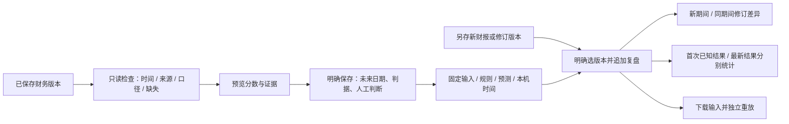

# 前向研究账本与财务资料检查

日期：2026-10-20。这个增量让研究判断在结果出现之前保存，之后用明确的财报版本复盘。复用已有财务计算、五因子规则、验证条件和 SQLite，没有引入新框架、生产依赖或外部调用。

## 可以怎样用

启动 `signal_validation_app.py`。独立入口为 [本机验证页](http://127.0.0.1:8550/)，需要服务运行。按用户反馈，验证工具已移出 Studio 导航；电脑主界面继续使用 [原 Studio](http://127.0.0.1:8528/)。本文后面的测试表保留当时阶段记录，恢复记录见[电脑界面恢复](DESKTOP_RESTORE_2026-10-20.md)。

1. 打开“前向研究”，默认是隔离演示，使用临时库与明确标注的虚构时钟。
2. 保存前向登记，再模拟新财报到来，点击“检查并追加复盘”。
3. 模拟财报修订并再次复盘，查看同期间数值变化、首次结果与最新结果。
4. 选择旧复盘，校验或下载包含原始输入的重放包，旧结果保持不变。
5. 实际使用时切换“本机工作台”，明确连接电脑端资料。先在“数据检查”检查已保存的财务版本，再登记未来研究。

```powershell
python -m streamlit run signal_validation_app.py --global.developmentMode false --server.address 127.0.0.1 --server.port 8550 --browser.gatherUsageStats false --theme.base dark

# 只读检查，默认详细报告留在被 Git 忽略的本机 data/ 中。
python -m scripts.audit_research_inputs

# 完整离线测试；外网与正式数据库访问受守卫阻断。
python -m scripts.run_offline_tests --mobile --output artifacts/forward-ledger-regression-2026-10-20.json
```

页面没有自动抓取、自动登记、定时复盘或后台付费任务。人工判断可以留空；选择明确判断时必须填写理由并关联所选版本的财务证据。它不会被标记成真实模型预测。

## 从保存到复盘



## 检查规则与实际资料状况

`ReadOnlyWorkbench` 以 `mode=ro` 和 `query_only` 读取已有文件，不构造会初始化数据库的 Workbench。缺文件、缺表、无权限或损坏会提示错误，不创建空的正式数据库。

检查要求有 1–1000 条标准 `financial_records`，明确公司、币种、单位、期间范围、报表范围、来源和取得日期。保存时间必须含时区；同日取得时间若晚于保存时刻也会拒绝。缺指标不补零，部分记录不可用、因子不足或财报超过 550 天会明确提示；没有可比因子时不能登记。已标记虚构或来源使用 `.invalid` 的数据不能进入真实账本。

本机只读盘点发现：**1 家自选公司、0 份独立标准财务版本、0 份可开始验证的输入**。检查前后正式数据库字节一致；没有替用户生成真实判断或登记。详细公司资料与检查文件没有上传。需要在电脑端核对原始财报并导入标准记录，才能积累真实前向样本；已有行情摘要不能冒充历史财报档案。

这些检查验证输入契约及声明的元数据，不认证网站、财报真实性或来源完整性，也不能识别所有未标记的伪造资料。

## 存储、并发和时间边界

| 内容 | 实现 |
| --- | --- |
| 登记表 | `signal_registrations`：输入快照、规则、分数、判据、预测、人工依据、请求指纹与校验和 |
| 复盘表 | `signal_reviews`：明确数据版本、截止日、结果、差异、重放输入与校验和 |
| 创建时机 | 首次明确保存且成功时，在已有工作台文件内增量创建这两张附加表及索引/触发器；失败事务连建表一起回滚 |
| 写入事务 | `mode=rw`、外键、`BEGIN IMMEDIATE`、20 秒连接等待；不改写既有财务表和历史研究表 |
| 重复提交 | 保存请求幂等；同公司/决策日/判据不能重复计数；复盘相同输入重试返回同一版本 |
| 追加保存 | SQL 触发器拒绝 UPDATE/DELETE；读取校验内容哈希，复盘重新计算校验 |
| 来源变化 | 已登记或已复盘的同 ID 财务版本被原地修改时拒绝使用，应另存版本 |
| 时间 | 应用赋予带时区时间；决策日必须晚于本机今日且在未来一年内；检测时钟倒退，不接受未来截止日或未来才保存的数据 |
| 读取规模 | 概览最多 200 项登记；页面显示最近 50 条复盘。首次结果统计读取这些登记的完整复盘历史，避免分页丢失早期结果 |

本机时间与数据库管理员可控；哈希和触发器用于检测意外修改，**不是第三方授时、不可篡改存证或可信历史数据库**。登记暂不提供编辑、撤回、删除界面，判断变化应在新决策日另登记。扩大规模前需要分页、备份与性能评测。

## 复盘与统计口径

目标任务沿用上一阶段的明确财务判据：同一未来财报期营业收入同比 ≥ 0 且净利润 > 0，币种、范围、期间口径一致。它验证财务条件，不预测股价。

未到决策日、未到复盘日、没有可比结果都保持未知。默认统计使用**首次保存的已知结果**；可单独选择最新复盘，结果曾发生变化时始终保留修订标记。历史日期的统计不读取日后才保存的判断或复盘。财报修订不会改写原判断、首次结果或旧快照。

规则与增长基线使用同一批有判断、有结果的样本；加入人工判断时重新取共同样本。未登记的人工判断保持空，不能用规则结果填充。真实资料与虚构演示完全分组。输出是描述性统计，未做显著性检验或同公司跨期相关性调整。

`replay_review(saved['replay'])` 不读取数据库或当前最新数据，能独立重算保存结果。重放包还保存前次复盘来源，用于逐项核对同期间修订。

## 文件与验收

- 新增 `src/research_readiness.py`、`forward_ledger.py`、`forward_demo.py`、`forward_research_ui.py`。
- 新增 `scripts/audit_research_inputs.py`、`test_forward_ledger.py`、`check_forward_browser.py`。
- 修改 `src/research_signals.py`，提取共用判据契约；修改 `src/signal_validation_ui.py`、`signal_validation_app.py`，加入前向研究与数据检查；更新离线测试清单。
- 更新 README、架构、变更记录、文档索引、今日报告和虚构截图。

本轮基线 **38/38 套件、322 单元测试**，见[基线](../artifacts/forward-ledger-baseline-2026-10-20.json)。最终测试数字与浏览器记录见下方交付结果及[今日报告](DAILY_2026-10-20.md)。

| 验收 | 实际结果与证据 |
| --- | --- |
| 完整离线回归 | [39/39 套件、364 单元测试通过](../artifacts/forward-ledger-regression-2026-10-20.json)，含移动 API 与控制器 |
| 新增后端及页面 | 42 项通过，覆盖并发幂等、回填拒绝、源版本变化、事务回滚、首个结果不因分页丢失、页面完整流程 |
| 前向账本浏览器 | [11 项通过](../artifacts/forward-ledger-browser/checks.json)，包括登记、未知、修订、导出、重放、三种宽度 |
| 原有研究信号 | [10 项通过](../artifacts/forward-ledger-signal-regression/checks.json)，包括 Studio 入口与返回历史 |
| 原 Studio | [21 项通过](../artifacts/forward-ledger-studio-regression/browser-checks.json)，含引用、版本、导航、草稿与财务工具 |
| 正式库只读检查 | [数据库字节未变](../artifacts/forward-ledger-readonly-check.json)，零真实登记、零外部 API 调用 |

完整回归首轮为 38/39：新增的长历史分页测试超过单套件 90 秒上限，其余套件通过。该测试改为复用另行验证过的两份数值结果，只验证分页与首次结果选择；重新运行后 42 项新增测试及完整 39 套件全部通过。没有提高超时或关闭守卫来掩盖失败。长历史反复重放的性能仍是已知优化项。

开发验收修正了预览与登记证据编号不一致、修订仅对比登记基线而遗漏同期间变化、模拟时钟变化后控件日期未同步、下载引发整页刷新和统计分页丢失首次结果等问题。下载使用兼容 Streamlit 1.41 的 fragment 隔离；浏览器在页面完成更新后验证导出内容。

完整测试阻断外网和正式数据库；浏览器仅允许回环地址。截图和写入测试全部用隔离虚构数据。本轮不调用模型、Tavily、行情、微信或交易接口；发布使用 `[skip ci]`。

发布前[完整暂存树扫描](../artifacts/forward-ledger-publish-safety-2026-10-20.json)未发现私有文件或密钥；[文档检查](../artifacts/forward-ledger-document-check.json)覆盖本轮七份文档的本地链接与图片。原始盘点、正式数据库、密钥、日志和中间截图不纳入发布。

## 下一步

先导入核对过的真实财务版本，积累实际前向样本和到期复盘，再决定是否增加行业/预测时距分组和经过授权的真实 Agent 判断。收益回测仍需要历史股票池、复权行情、交易日历、退市与交易成本设计；当前没有真实收益或模型优越性结论。
