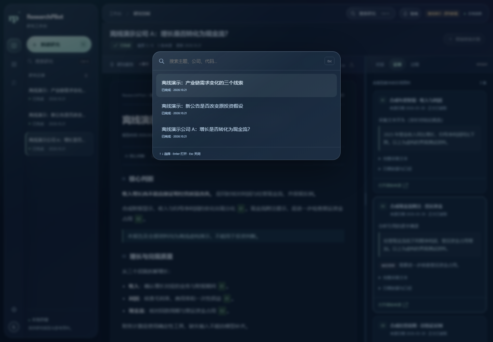

# Studio 玻璃材质交付记录

日期：2026-10-22（Asia/Shanghai）。依据用户“像 iOS 那种 glass 质感”的要求，在线阅读 Apple 和 MDN 官方资料后，在原深色 Studio 上增加网页玻璃材质。保留导航、研究流程、历史版本和分栏，没有另做主界面或替换研究引擎。

## 在线参考与设计取舍

本轮使用 agent-reach 的网页路线，通过无需密钥的 Jina Reader 读取以下公开文档，未使用付费检索或模型 API：

| 来源 | 实际参考点 | 本项目处理 |
| --- | --- | --- |
| [Apple HIG：Materials](https://developer.apple.com/design/human-interface-guidelines/materials) | Liquid Glass 用于导航、控件等功能层；正文采用普通材质；避免过量堆叠 | 侧栏、顶栏、工具条、搜索弹层使用磨砂材质；报告与表格保持清晰 |
| [Apple：Adopting Liquid Glass](https://developer.apple.com/documentation/technologyoverviews/adopting-liquid-glass) | 无需重做原应用；圆润控件、层次和对无障碍设置的响应 | 保留原布局；胶囊按钮、圆角浮层与细高光；响应系统设置 |
| [MDN：backdrop-filter](https://developer.mozilla.org/en-US/docs/Web/CSS/backdrop-filter) | 透明背景配合背景滤镜；留意 backdrop root 与旧浏览器兼容 | CSS 背景模糊及 WebKit 前缀；不用父元素整体 opacity；不支持时实色回退 |
| [MDN：prefers-reduced-transparency](https://developer.mozilla.org/en-US/docs/Web/CSS/@media/prefers-reduced-transparency) | 减少透明度媒体查询尚非所有浏览器通用 | 兼顾系统偏好和明确的手动实色开关 |

这是网页中的 Liquid Glass 风格近似，不是 Apple 原生材质或完整光学折射模拟。没有引入 SwiftUI、WebGL、重型滤镜库、外部字体、图片或新依赖。

## 实际效果

- 原深色工作台采用固定的蓝绿/淡紫环境渐变；侧栏、顶栏形成圆润、半透明的功能浮层。
- 24px 背景模糊、饱和度调整、顶边高光和内外阴影共同构成材质；窄屏模糊降低为 18px。
- 按钮、选中导航和标签使用圆润边缘；指针移动时，局部高光跟随控件内的位置。仅精细鼠标设备启用，每帧最多一次更新，离开、滚动、窗口失焦即清理。
- 原有页面切换、悬浮提示、引用预览、键盘搜索和分栏拖动继续使用原实现，不叠加新的循环动画。
- 报告纸面为不透明实底，不模糊文字。正文实测前景/背景对比度 **11.49:1**，该指标不代表所有文本和所有状态均已做完整无障碍审计。
- 顶栏的“玻璃 / 实色”按钮可用键盘切换，只保存本机外观偏好；不会清空研究草稿或改动账户、报告和数据。
- 系统减少透明度、提高对比度、强制颜色或浏览器不支持背景滤镜时，使用实色；系统减少动效时停止指针反光跟踪，沿用原有动画降级。

本轮应用于**电脑 Studio 和它的窄屏布局**。独立手机网页及微信原生页面保持原样，未宣称已同步新材质。

## 使用与截图

电脑主入口仍为 [原 Studio：8528](http://127.0.0.1:8528/)。刷新可加载新材质；服务需运行。右上角水滴按钮可以切换实色外观。

以下展示全部为隔离虚构数据，未截取真实研究或财务资料。




## 测试和修正

| 检查 | 结果 |
| --- | --- |
| 修改前完整离线基线 | [39/39 套件、365 单元测试通过](../artifacts/glass-baseline-2026-10-22.json) |
| 修改后完整离线回归 | [39/39 套件、365 单元测试通过](../artifacts/glass-regression-2026-10-22.json)，含移动 API 和控制器 |
| 新材质专项浏览器检查 | [17 项通过](../artifacts/glass-ui-2026-10-22/acceptance/checks.json) |
| 原 Studio 交互回归 | [21 项通过](../artifacts/glass-ui-2026-10-22/studio-regression/browser-checks.json) |
| 新材质浏览器异常 / 外部请求 | 0 / 0 |
| JavaScript 语法 | `node --check src/studio_component/glass.js` 通过 |

专项覆盖：真实 CSS 模糊与透明层、鼠标反光、键盘切换、刷新持久化、草稿不变、正文实底与对比度、引用与搜索、390/1024/1440 宽度、减少动效、系统减少透明度/提高对比度/强制颜色、存储不可用、模拟滤镜不支持、44px 触屏外观按钮和抽屉导航。

开发中修正了实色模式下个别浮层仍保留透明背景的问题。测试首轮也发现刷新后沿用旧 iframe 对象、能力模拟未真正注入，以及窄屏截图在抽屉过渡中途截取等问题；修正定位与模拟方式，明确确认注入并等待真实尺寸和抽屉状态，再重新执行整套验收，没有跳过失败条件。

上述系统偏好与滤镜能力是 Chromium 中的仿真验证；尚未做实体 iPhone、Safari 或低端设备的性能验收。未宣称具有原生 iOS 的完整折射效果或已达到某个帧率。

## 文件、运行和边界

新增 `src/studio_component/glass.css`、`glass.js`、`scripts/check_glass_browser.py`；修改 `index.html` 以加载材质及外观按钮。文档更新为 README、CHANGELOG、文档索引和本报告；新增三张虚构展示截图及测试结果。

```powershell
# 原电脑工作台
python -m streamlit run studio_app.py --server.address 127.0.0.1 --server.port 8528

# 单独终端：只用临时虚构资料的验收服务
python -m streamlit run scripts/preview_studio.py --global.developmentMode false --server.address 127.0.0.1 --server.port 8554 --browser.gatherUsageStats false

# 已有 Playwright + Chromium 的开发环境
python -m scripts.check_glass_browser --url http://127.0.0.1:8554
python -m scripts.check_studio_browser --url http://127.0.0.1:8554
python -m scripts.run_offline_tests --mobile
```

所有写入测试用临时库，完整离线回归阻断外网和正式数据库。在线资料只用于设计调研，不会成为页面运行时依赖。本轮没有模型、Tavily、行情、微信或交易调用，没有数据库迁移、密钥修改和自动监控。

发布按文件白名单、[完整暂存树密钥扫描](../artifacts/glass-publish-safety-2026-10-22.json)和 `[skip ci]` 进行，避免主动运行云端 CI；另有[文档链接与图片检查](../artifacts/glass-document-check-2026-10-22.json)。今后优先补充真实 Safari/手机的材质与性能检查，再决定是否把这套材质扩展到独立手机页面。
