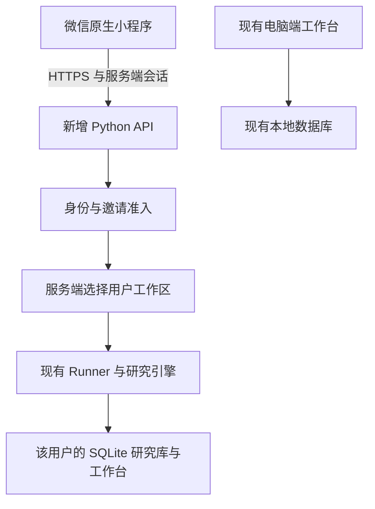

# 微信小程序体验版：范围、代码审查与前置改动

日期：2026-10-19。用户已确认先供本人和少量朋友体验。

**本文是前置审查与存储修复阶段的历史记录。后续已新增原生页面和 API，详见 [本地开发交付](MINIPROGRAM_LOCAL_DELIVERY_2026-10-19.md)。微信真机、公网部署和体验码仍未完成；下文“尚未实现”指该次审查时点。**

## 产品范围

移动端第一版计划覆盖四条完整流程：

1. 输入研究问题与搜索次数上限，提交后台任务。
2. 查看任务状态、研究步骤、失败原因，手动暂停或恢复；离开页面不取消后台任务。
3. 阅读已保存的报告版本、原始证据、来源日期与未解决问题。
4. 管理自己的自选公司，查看已有财务概览和对应研究。

界面延续深色金融终端风格，但采用单栏、底部导航和分段详情页，重新安排手机上的字号、触控区域和阅读顺序。桌面多栏布局不直接缩小搬到手机。

财报 PDF 导入、复杂同业比较和批量维护先保留在电脑端。付费订阅、交易、公开注册和自动推送不在本轮范围内。

## 真实代码审查

| 现有代码 | 已有能力 | 对小程序的意义 |
| --- | --- | --- |
| `src/agent.py` | 有限迭代、检索与阅读、确定性财务工具、研究验证 | 继续复用 Python 引擎 |
| `src/background.py` | 后台线程、持久命令、跨进程任务锁 | 任务提交与读取分开；页面轮询状态 |
| `src/storage.py` | 研究状态、历史列表、SQLite 快照 | 可按指定数据库建立研究仓库 |
| `src/workbench.py` | 自选、档案、财务版本、观点及任务命令 | 可复用业务存储；当前表没有用户归属字段 |
| `src/studio_bridge.py` | 页面数据视图、命令校验、任务创建 | 可提取数据转换与业务校验；当前组件桥不是公开 API |
| `src/studio_company.py` | 版本化财务概览、证据、研究时间线 | 可作为移动端公司概览的业务基础 |

仓库目前没有独立 FastAPI/Flask API、微信身份交换、会话鉴权或邀请准入。Streamlit 页面不能直接变成原生微信小程序。

现有后台执行在服务进程存活期间继续运行。服务重启后需要明确恢复任务；不得将其描述为已有可靠分布式任务队列。

## 本次实际改动

审查发现：`Runner` 已能注入 `store`，但 `agent.tick` 的行情与财务分支直接构造默认 `Workbench()`；行情失败后还会再次读取默认财务数据库。只在 API 层分配不同 `Runner` 并不足以约束这两条路径。

现已改为：

- `tick(state, *, store=None)` 接收调用方拥有的工作台。
- `Runner` 每一步传入自己的 `store`。
- 行情缓存读取、新快照保存、财务读取与异常回退均使用同一个工作台。
- 注入的工作台出错时，不改读默认数据库。
- 现有 `tick(state)` 调用仍使用默认桌面工作台。

没有数据库迁移、复制历史库、修改密钥、增加依赖或调用真实模型。

**这项改动只消除引擎里的隐式默认库访问，不等于实现用户身份、授权或完整多用户隔离。**

实际修改的代码与测试：

- `src/agent.py`
- `src/background.py`
- `scripts/test_workspace_context.py`：新增 6 项回归
- `scripts/test_workbench.py`、`scripts/test_v2_quality.py`：测试替身接受新的工作台参数，并断言使用正确实例
- `scripts/run_offline_tests.py`：将新测试加入显式离线清单

## 建议的增量架构

优先新增独立 FastAPI 入口和可选依赖文件，保留桌面入口。小范围体验先考虑每个用户一组独立 SQLite 文件，复用现有表设计，避免直接迁移整个桌面数据库。工作区由服务端内部用户 ID 映射，客户端不能传入数据库路径。

即使只有几位朋友，也要有独立身份与任务归属。默认不向新用户共享本人的研究历史、自选、投资观点或 API 配置。本人接入桌面历史及跨设备同步的具体策略在身份层就绪后设计，不能暗中复制或直接公开整库。

第一版使用一个 API 服务进程与有上限的工作区/Runner 注册表，不配置多个无约束的独立 worker。任务线程数、全局同时运行数、单用户同时运行数、日任务数和搜索上限均在服务端校验。已有搜索上限并不等于模型金额硬上限；费用估算缺少用量或价格配置时继续标明未知。

若以后用户量增加，再依据实际任务负载评估共享数据库、独立任务队列和扩容，不预先替换 Agent 框架。

## 接口计划（尚未实现）

| 接口 | 行为与边界 |
| --- | --- |
| `POST /v1/auth/wechat` | 服务端交换微信临时凭证，校验邀请资格，签发可过期和撤销的应用会话 |
| `GET /v1/me`、`POST /v1/auth/logout` | 获取当前身份与配额；退出并撤销当前会话 |
| `GET /v1/runs` | 仅列出本人任务，有限分页 |
| `POST /v1/runs` | 校验输入、准入和配额，持久化后返回任务 ID；支持幂等请求，避免重试重复扣费 |
| `GET /v1/runs/{id}` | 验证任务归属后返回状态、版本及有限大小的证据视图 |
| `POST /v1/runs/{id}/commands` | 验证归属及状态后提交暂停/恢复命令；不让客户端任意扩大费用上限 |
| `GET /v1/runs/{id}/reports/{version}` | 读取该任务保存的指定版本；不能以当前证据冒充旧版本证据 |
| `GET/POST /v1/watchlist` | 本人自选的查询与校验后新增 |
| `DELETE /v1/watchlist/{symbol}` | 仅移除本人自选关联；不删除历史研究 |
| `GET /v1/companies/{symbol}` | 返回本人已有财务版本、原始单位、财报期、来源与研究关联 |

模型密钥、微信 AppSecret 和微信会话密钥只留在后端，不进入小程序包、响应、错误正文或 Git。普通读取不启动模型或自动拉取行情。前端关闭页面后停止轮询；后台继续执行，服务重启后的恢复策略明确展示。

## 开发顺序与验收

1. **存储依赖边界**：本次已完成并增加回归；完整结果见下文。
2. **API 与身份层**：临时数据库离线测试。验证未登录拒绝访问、邀请失效、会话过期/撤销、跨用户读取/命令均失败、并发配额与幂等创建。未授权请求不能创建任务或产生模型费用。
3. **原生页面**：研究首页、任务/报告详情、自选/公司详情、账号页。开发者工具中验证加载、空数据、失败、切页、长文和来源访问，不用静态演示冒充联网研究。
4. **部署与真机验收**：专用测试环境、HTTPS、域名配置、微信账号和体验成员；本人及朋友分别验证数据可见性。使用真实 API 的小额验收需有明确次数限制并记录实际调用。

后续代码可先在本地进行开发与离线验证。要让朋友实际打开体验版，仍需配置微信小程序 AppID/后台权限，以及他们能访问的服务器与域名；仅本机 `127.0.0.1` 服务无法满足该场景。AppSecret 应由用户在服务器环境中设置，无需发送到聊天里。

## 测试记录

- 修改前基线：**33/33 离线套件，252 项单元测试**。见 `artifacts/miniprogram-baseline-2026-10-19.json`。
- 首次受限沙箱运行：23/33 套件通过，Windows 的 `socketpair` 本机通信被系统沙箱拒绝。授权本机测试通信后，同一基线通过；测试脚本的外网及真实 `data/` 数据库禁止访问保护未取消。首次记录保留于 `artifacts/miniprogram-sandbox-attempt-2026-10-19.json`。
- 新增定向测试：**6/6 通过**。覆盖两个工作台同股票的缓存/财务分离、新快照写入位置、行情失败后的财务回退、存储失败不回读默认库、旧调用兼容以及 Runner 传递实例。
- 首次修改后回归：33/34 套件通过，失败项是旧测试替身未接受新增 `store` 参数。已更新两处相关测试替身，同时断言使用调用方的实例；记录见 `artifacts/miniprogram-foundation-first-run-2026-10-19.json`。
- 最终完整回归：**34/34 离线套件，258 项单元测试**。见 `artifacts/miniprogram-foundation-regression-2026-10-19.json`。所有套件通过，未调用真实模型、微信登录或行情服务。

上述均为离线测试，不是微信开发者工具、微信登录、真机或公网部署验收。

## 微信接入要求的核验状态

本次尝试通过 agent-reach 的 Exa 检索、备用搜索与官方页面访问核验文档。Exa 网络失败，备用搜索未得到结果，官方页面读取失败，Jina 官方页读取超时。因此本报告没有声称核验了 2026-10-19 的成员额度、主体资格、金融类目、备案材料或审核结论。

接入前应在当前微信管理后台及下列官方文档核验：

- [网络能力](https://developers.weixin.qq.com/miniprogram/dev/framework/ability/network.html)
- [小程序登录](https://developers.weixin.qq.com/miniprogram/dev/framework/open-ability/login.html)
- [发布流程](https://developers.weixin.qq.com/miniprogram/dev/framework/quickstart/release.html)

本项目含公司及金融研究信息，公开发布时按实际功能和主体核实类目与材料，不以更改名称代替核验。本次范围是小范围体验准备，没有提交审核或承诺个人主体可公开发布全部功能。
