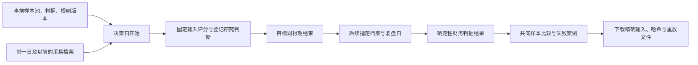
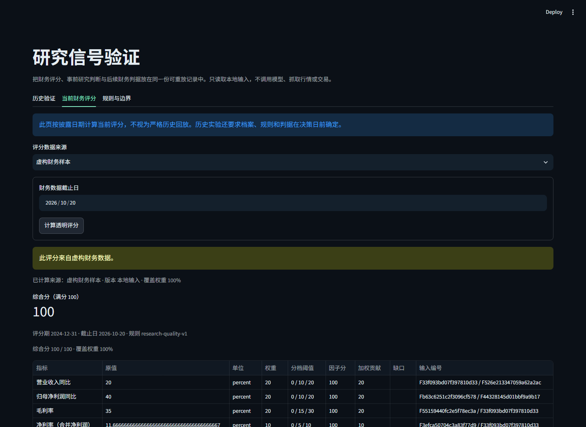

# 研究信号评分与历史验证 · 离线原型

日期：2026-10-20。复用现有 `financial_quality`、Decimal 财务计算与 `thesis_tracking`，新增透明评分和事前档案的对照评测。不调用模型、搜索或行情接口，不运行交易。

## 使用

当前本机独立入口：[研究信号验证](http://127.0.0.1:8550/)，服务运行时可用。在“历史验证”点击“运行离线验证”，查看虚构案例；“当前财务评分”可计算虚构或本地输入。

Studio 左侧新增“研究信号验证”；可从自选公司的明确财务版本计算当前分数，并返回原研究页面。Studio 集成在隔离虚构预览中验收，原电脑和手机服务没有被重启。

```powershell
# 独立页不加载 .env、不构造 Runner，也不打开默认数据库。
python -m streamlit run signal_validation_app.py --global.developmentMode false --server.address 127.0.0.1 --server.port 8550 --browser.gatherUsageStats false --theme.base dark

# 离线黄金案例评测。
python -m scripts.evaluate_research_signals --demo

# 从保存的完整结果重放；也支持直接输入实验 JSON。
python -m scripts.evaluate_research_signals --input artifacts/research-signals-evaluation.json --as-of 2026-05-02 --output artifacts/research-signals-replay.json
```

实验输入及上传均为本地 JSON，上传限 2 MB。页面结果保存在当前会话，可下载含所有输入的重放文件；尚未增加数据库实验登记/自动调度，不假称已建立真实事前样本库。

## 评分规则

| 因子 | 权重 | 三个递增阈值 |
| --- | --- | --- |
| 营业收入同比 | 20 | 0%、10%、20% |
| 归母净利润同比 | 20 | 0%、10%、20% |
| 毛利率 | 20 | 0%、15%、30% |
| 同范围净利率 | 10 | 0%、5%、10% |
| 同范围现金兑现率 TTM | 30 | 0.5、1、1.2 倍 |

每项根据满足的阈值个数取得 0/40/70/100 分，综合分为 `Σ(因子分 × 权重 / 100)`。阈值包含等号。全覆盖且综合分不低于 60 时标记为研究候选；这只是手工规则，没有进行权重寻优或收益训练。

五项必须全部可计算才给综合分。缺项不补零、不重分配权重，展示已有贡献和覆盖权重；负基期增长率、非正现金流分母、缺口径、跨币种或冲突数据沿用原计算模块的不可用状态。风险标志独立展示，不被悄悄换算成扣分。

公式、因子原值、各项贡献、原始记录与派生输入均可查看。决策证据只导出真正参与计算且有效的来源链；被阻断或未来才披露的数据不会进入该证据集合。完整输入档案仍保留在重放清单中，便于审计排除原因。

目前不含估值、行业中性化或金融业专用评分。现金兑现率使用合并净利润，不用归母利润替代同范围分母。分数是规则结果，不代表市场预期收益。

## 日期与版本契约



- 决策日按当日开始处理：档案采集日、样本池形成日、判据登记日、规则登记日、研究判断登记日均须更早。当天采集不推定在决策前可用。
- 元数据接受 ISO 日期；时间戳须带时区，换算为 Asia/Shanghai 后比较。档案不能含采集之后才取得的数据。
- 评分使用明确指定的档案编号；缺少档案时拒绝，不用最新版本替代。公司、币种、范围、目标期间必须一致。
- v1 的验证任务固定为同一未来财报期“收入同比 ≥ 0 且净利润 > 0”。两项数据全部可验证后，才产生满足/未满足标签。
- 目标期末须晚于决策日。未到复盘日、结果档案未形成或数据不足均为未知，不计作预测失败。
- 当前真实规则版本登记日为 **2026-10-20**，不会默认允许它回到 2025 年。演示使用独立的 `synthetic-research-quality-v1` 及明确虚构的 2025 年登记日期。

日期与样本池都是用户输入的声明；文件哈希验证重放一致性，不独立认证当时确有这些档案。因此本原型不是已认证的历史因子数据库，也没有解决历史股票池和幸存偏差。

## 对照评测

增长基线只检查当期收入同比与归母利润同比均不低于 0。综合规则按上述评分产生判断。可选的登记研究判断必须为布尔值，绑定档案哈希、判据哈希、事前登记时间和有效证据编号。未提供、超时或绑定不符时保持未判断，不把规则结果填成 Agent 预测；引用存在仍不等于语义支持。

分别提供“规则/基线共同样本”和“三种方法共同样本”，所有比较都在各自同一批样本上进行。另列全部样本的判断覆盖数、可验证数和总数；禁止用更多的基线样本与更少的研究样本直接比较正确率。

输出 TP/TN/FP/FN、正确率、精确率和召回率，分母为零时为 null。它们是描述性统计，不包含显著性检验，也未处理同公司跨期相关性或不同预测时距的统计推断。

### 固定虚构数据集

`evals/research_signal_cases.json` 保存 5 个样本、10 份档案；独立的 `research_signal_expectations.json` 保存手算预期。

| 样本 | 综合分 | 后续财务判据 | 用途 |
| --- | --- | --- | --- |
| fictional-1 | 100 | 满足 | 基础正例 |
| fictional-2 | 44 | 未满足 | 盈利和现金流偏弱 |
| fictional-3 | 58 | 未满足 | 增长基线出现假阳性 |
| fictional-4 | 未知，覆盖 70% | 满足 | 缺失现金流不凑综合分 |
| fictional-5 | 100 | 未满足 | 高分后的失败案例 |

共同样本为 4 个；增长基线对应 2/4，综合规则和虚构登记判断各 3/4。**这些数值是特意构造的验收案例，不是真实模型成绩，不证明优于基线或具有投资价值。**

## 测试与交付文件

修改前基线：37/37 套件、286 单元测试。最终 **38/38 套件、322 项单元测试全部通过**，见[完整回归](../artifacts/research-signals-regression-2026-10-20.json)。

- 新增算法与页面测试：36 项，涵盖手算值、数据缺失、输入不变性、同公司版本、时区/日期、防前视证据、未到期标签、规则参数、重复样本、共同样本和页面表单。
- 黄金评测：6/6 项预期断言通过，包含全部分数/标签、共同样本与三种混淆矩阵。命令行导出重放逐字节一致。
- 新页面/Studio 集成：[10 项浏览器检查](../artifacts/research-signals-browser/checks.json)；原 Studio：[21 项浏览器回归](../artifacts/research-signals-studio-regression/browser-checks.json)。均使用隔离虚构数据。
- 核心：`src/research_signals.py`、`research_signal_fixtures.py`。
- 页面：`src/signal_validation_ui.py`、`signal_validation_app.py`；修改 `studio_app.py`、`src/studio_bridge.py` 和组件导航。
- 工程：`scripts/test_research_signals.py`、`evaluate_research_signals.py`、`check_signal_browser.py`，更新显式离线测试清单。

没有新增生产依赖、数据库迁移、交易或真实服务商调用。浏览器阻断外部请求。完整回归继续禁止外网和生产数据库访问。

发布仍按明确文件白名单进行，完整暂存树的[密钥/私有文件扫描记录](../artifacts/research-signals-publish-safety-2026-10-20.json)为零发现。虚构输入与截图才纳入仓库；重放副本、临时运行状态及旧截图保留本地。提交使用 `[skip ci]`，避免触发可能计费的云端任务。

开发中修正过两类验收问题：AppTest 需要把日期与表单提交作为同一次交互；测试浏览器须操作 Streamlit 可见的单选标签，并向原生日期输入传 ISO 值。早期预览进程仍保留旧模块，导出中缺少新字段；仅重启本轮自己的验证进程后，最终导出与重放一致。未重启原电脑/手机服务。

## 页面截图




## 下一步

先用今天之后实际保存的档案积累前向样本，人工登记明确判据和研究判断；复盘到期后检验真实覆盖与失败原因。之后再考虑可信的事前 SQLite 登记、按行业/时距分组、更多明确目标任务，以及在复权行情与历史股票池齐备后开展收益检验。
