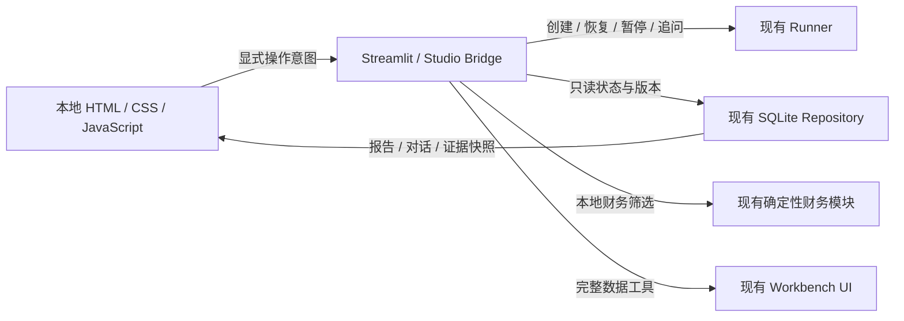

# ResearchPilot Studio 界面重构与验收记录

日期：2026-10-14。对应需求：界面升级不能只调整颜色，需要改变研究阅读与核查的操作体验。

## 已落地的变化

| 操作 | 原研究界面 | Studio |
| --- | --- | --- |
| 阅读时追问 | 在报告与对话标签之间切换 | 报告常驻中间，对话在右侧并排显示 |
| 核对引用 | 离开报告，查证据列表 | 点击 `[E1]`，右侧定位并高亮对应版本的证据 |
| 追溯旧回答 | 弹窗查看消息快照 | 打开回答所关联的报告版本，报告与证据共同切换 |
| 长报告导航 | 纵向滚动 | 章节目录、报告独立滚动、侧栏可调整宽度 |
| 查找任务 | 原生侧栏长列表 | 固定任务库、Ctrl/Cmd K 搜索、方向键与 Enter 打开 |
| 保存草稿 | Streamlit 会话内保存 | 当前浏览器 sessionStorage 保存，支持同标签页刷新恢复 |
| 财务筛选 | 表格与原始 JSON | 自选池筛选、点击数值查看公式、期间、原始值、披露日期和来源 |
| 手机阅读 | 依赖原生页面缩放 | 抽屉式任务库、报告与助手切换、引用自动打开证据面板 |

视觉调整服务于上述结构：较轻的导航、独立文档画布、固定操作区、清晰的标题层级和更适合阅读的正文。未使用外部字体、图片 CDN 或前端框架。截图中的数据、公司与来源全部为虚构，明确标注离线演示。

## 实际修改文件与架构

- `studio_app.py`：新增应用入口，负责组件宿主、四秒状态轮询及旧完整数据工具入口。
- `src/studio_bridge.py`：只读展示契约、来源与引用快照分离、前端操作白名单、任务身份校验、事件去重与参数校验。
- `src/studio_component/index.html`：固定导航、任务库、工作区、搜索弹窗的结构。
- `src/studio_component/studio.css`：桌面分栏、文档与输入卡片、手机布局和减少动态效果偏好。
- `src/studio_component/studio.js`：安全 Markdown 子集、引用定位、版本选择、下载、搜索、草稿、可调整面板、筛选追溯交互。
- `scripts/test_studio.py`：14 个离线契约/入口测试。
- `scripts/preview_studio.py`：隔离的临时数据库和合成样例，不执行模型或任务命令，不抓取网络数据。
- `scripts/check_studio_browser.py`：可重复执行的真实浏览器验收。
- `scripts/run_offline_tests.py`：将 Studio 契约加入显式离线测试清单。
- `README.md`、本报告：启动方式、能力变化及限制。
- `docs/architecture.md`、`docs/V2_ARCHITECTURE.md`、`docs/README.md`：新增入口与组件边界、文档索引。
- `artifacts/studio-*`：真实基线、回归、浏览器、正式入口验收结果和虚构数据截图。
- `artifacts/agent-evaluation.json`：回归脚本重新生成的原评测结果。



无破坏性数据库迁移；未替换 Agent 引擎，未修改原始研究、财务计算和监控策略。旧 `agent_app.py` 与工作台保留。Studio 展示直接读取 Repository，不调用会保存历史规范化结果的 `Runner.read`。打开历史任务、切换视图与筛选不会发起模型请求；创建研究和正式追问仍沿用已配置的后台服务。

## 验证结果与证据

| 检查 | 结果 | 证据 |
| --- | --- | --- |
| 修改前基线 | 24/24 组，164 个单元测试通过 | `artifacts/studio-baseline-2026-10-14.json` |
| 修改后全量离线回归 | 25/25 组，178 个单元测试通过 | `artifacts/studio-regression-2026-10-14.json` |
| JavaScript 语法 | Node `--check` 通过 | `src/studio_component/studio.js` |
| 隔离浏览器验收 | 15/15 项，页面错误 0 | `artifacts/studio-preview/browser-checks.json` |
| 正式入口只读验收 | 读取真实历史、打开已完成报告及筛选页面；页面错误 0，付费命令 0 | `artifacts/studio-live-smoke-2026-10-14.json` |

全量回归使用 Python 3.11 与隔离安装的 Streamlit 1.65。浏览器与正式本地服务使用已安装的 Streamlit 1.63。未声称测试了整个 `streamlit>=1.41,<2` 版本范围。

浏览器覆盖：草稿跨页和刷新恢复、轮询保留报告滚动、引用定位、旧版本隔离、消息引用的版本绑定、假设与不确定性、键盘调整分栏、按选中版本导出、键盘搜索、确定性筛选与原始输入、危险 HTML/链接拒绝、完整旧工具可达，以及 1440/1024/390 像素视口。桌面与手机截图见 `artifacts/studio-preview/`。

开发中曾发现并修复两类验收问题：滚动断言受到平滑滚动影响，恢复位置改为立即定位；预览返回的数据缺少旧财务界面的 `created` 字段且被宿主资源缓存，已补齐元数据，并通过显式注入隔离服务避免继续使用旧样例。最终测试未遗留失败项。旧原生工具仍有 Streamlit `use_container_width` 弃用提示，不影响此次验收。

## 启动与复测

正式入口（当前本地地址 `http://127.0.0.1:8511`）：

```powershell
.\.venv\Scripts\python.exe -m streamlit run studio_app.py --server.address 127.0.0.1 --server.port 8511
```

独立离线预览（当前本地地址 `http://127.0.0.1:8510`）：

```powershell
.\.venv\Scripts\python.exe -m streamlit run scripts/preview_studio.py --server.address 127.0.0.1 --server.port 8510
$env:PLAYWRIGHT_BROWSERS_PATH='G:\ResearchPilot\.venv\playwright-browsers'
.\.venv\Scripts\python.exe -m scripts.check_studio_browser --url http://127.0.0.1:8510
.\.venv\Scripts\python.exe -m scripts.run_offline_tests --output artifacts/studio-regression-2026-10-14.json
```

浏览器验收需开发依赖 Playwright 和 Chromium，它们不是应用运行依赖。预览不会保存虚构数据到生产数据库。正式入口的验收没有截图或导出用户研究内容。

## 已知边界与后续工作

- 个股行情、财务导入、投资复盘、长期偏好与监控设置仍通过现有原生工作台访问，尚未全部迁入自定义前端；它们已验证可达。
- 新入口不启动第二个监控调度器；已有 `agent_app.py` 服务继续负责监控执行。若只运行 Studio，监控配置可以保存，但不会自动执行。
- 后台线程归属仍为进程级，尚无跨进程任务租约。不要在两个服务同时执行同一历史任务。页面说明“待恢复”只表示本服务没有活跃线程，不证明其他服务没有执行它。
- 本次保留已有服务，不中断历史任务。正式 Studio 未执行真实模型、搜索或行情 API 调用；新建和追问经过离线 Runner 契约验证，没有新增实盘或投资质量认证。
- Markdown 支持常用标题、段落、列表、表格、链接、代码与引用，不支持任意 HTML 或完整 Markdown/LaTeX 渲染。
- 任务库显示最近 100 条，键盘搜索在这 100 条内执行；更完整的历史分页仍可通过旧入口访问。
- 草稿属于当前浏览器标签页会话；不保证浏览器关闭后恢复，也不跨设备同步。敏感研究数据不会上传到新服务。
- 新界面没有新增付费依赖。状态轮询只访问本地数据库；Token 与费用仅显示历史实际记录，未知用量不推算。
- 后续可继续迁移财务导入/复盘表单，并把证据关系从展开明细升级为可导航的节点视图。当前并未将这些未实现项列为完成。

GitHub 提交与云端 CI 的最终结果在代码推送后补记；本地通过不等于云端通过。
