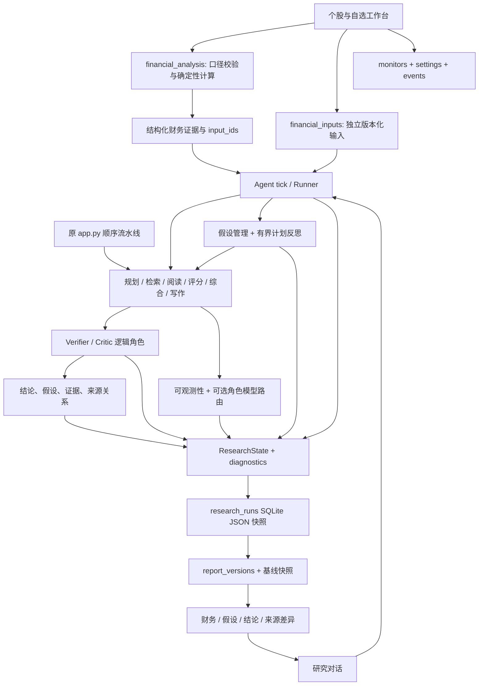

# v2.0 开发版本架构

2026-10-18 财报研究工具复用 `financial_analysis` 的归一化、披露截止日和 Decimal 运算。
新增 `financial_diagnostics` 生成七类规则线索与金额勾稽的利润变化桥；记录上下文、阈值、
观察值、公式和 input_ids。`attach_financial_analysis` 将它们作为结构化证据接入原 Agent，
并保存在 diagnostics。不以总营业成本代替营业成本，不以归母利润代替净利润分解。

`thesis_tracking` 独立验证用户定义的数值判据；SQLite 新增 `thesis_tests`（不可变判据版本）
及 `thesis_test_runs`（固定输入与日期的检查记录）。事务内校验当前判据版本并防止过期覆盖，
同一判据/数据/日期的重复执行幂等。人工 theses/review/thesis_history 保持原有写入路径。
展示只读，保存和执行均需显式白名单事件；前后端校验公司、输入版本、截止日和判据版本。
Studio 新增“财报侦察”，投资复盘增加结构化判据；旧服务数据缺少新字段时显示兼容提示。
详见 [本轮交付与评测](FINANCIAL_RESEARCH_2026-10-18.md)。

2026-10-18 增加逐句报告验证：`verify_report → claim_verification.verify_claims`
从具体报告句子关联其引用文档，保存完整原文片段与 Python 字符偏移、来源、日期及读取状态。
`supported` 仅指完整原文陈述匹配；一般语义仍 unknown。同文本主体/期间/单位的方向或百分比冲突
才参与报告阻断，避免整篇文档中其他公司数据造成误判。混合证据和未解决支持进入 Critic warnings，
由既有 Agent outcome 机制标为 partial。结构化财务数值继续由原 Decimal 工具处理。

`report_versions.verification` 与具体报告、证据一起哈希和保存；新增验证不回填已存旧版本。
展示层只读所选版本的检查，旧版本缺少检查时明确显示未保存。派生图新增 `report_claim` 节点及
`matches_statement / conflicts_with / conflicting_statements / cites_unverified` 边，
不把引用或文本匹配当作一般语义证明。复用 ResearchState diagnostics 和 SQLite JSON，未迁移数据库。
详见 [本轮交付及测试限制](CLAIM_VERIFICATION_2026-10-18.md)。

2026-10-15 公司驾驶舱复用原财务和记忆模块，新增本机跨进程 `WorkerLock`、持久化执行记录、筛选方案与固定输入执行快照。财务导入/版本、时间轴、档案/复盘在 Studio 内完成；所选财务版本和截止日作为结构化证据绑定新公司研究。详见 [完整交付与测试证据](COMPANY_COCKPIT_2026-10-15.md)。

沿用 Python、Streamlit、SQLite、OpenAI Chat Completions 与现有数据适配器。没有整体迁移框架。Studio、自主对话与原顺序流水线入口继续共用组件：

2026-10-14 新增 `studio_app.py`：本地自定义组件负责分栏工作区和交互，`studio_bridge` 提供只读展示与白名单操作契约。研究任务仍交由原 Runner 执行，财务模块与 SQLite 不变。Studio 不自动启动监控调度器。引用定位绑定保存的报告版本，不使用新证据回填旧版本。完整原生工作台作为数据工具入口保留。详见 [Studio 交付记录](STUDIO_INTERFACE_2026-10-14.md)。

## 财务契约

canonical financial_records 包含 metric、value、unit、currency、basis、scope、period_end、source_url；symbol/fetched_at 可由顶层提供，period_start 由明确季度口径校验/推导。published_at 用于防止估值前视。既有 Sina item_field/item_value 通过已核对 metadata 适配，不默认猜人民币、元或累计。

Decimal 精度 40，舍入明确为 ROUND_HALF_EVEN。跨期比较必须匹配实体、指标定义、币种、报表范围和期间口径。Q2/Q3/Q4 单季是当前累计减同年上一季度累计；Q1 等于 Q1 累计。累计毛利率不能直接差分。TTM 要求四个连续、唯一、通过校验的单季值。

PE 使用归母年度/TTM 净利润，PB 使用归母净资产；不能以总净利润替代归母净利润，也不输出亏损下误导性的正常 PE。市值日期、币种、来源与财报公告日期明确后才能估算。行情数据源的未知单位不能作为自动计算依据。

每个输入、派生季度和计算有内容 ID；input_ids 指向具体输入。图表浮点坐标只用于绘制，计算值和下载证据保留精确字符串。所有数值来自源值或 Python 运算，LLM 负责解释而不是计算工具的实现。

## 假设和反思

hypotheses 放在 diagnostics：content、criterion、origin、supporting、contrary、questions、judgment、uncertainty、history。规划模型可输出可证伪 hypothesis；没有它时记录待验证任务，不谎称已验证。用户投资观点与 Agent 假设分开，自动逻辑不覆盖原 theses/复盘。

当前已实现两类财务触发器：营收同比增长而利润同比不增长；利润同比增长而现金流同比不增长。必须同期间、同币种、同口径。反例只解释方向，不凭此归因。它们产生最多 2 次自动修订，分别追加毛利率/费用率/业务结构或现金流/应收/存货问题。

搜索预算不增加，默认 2、最多 16 个成功搜索；累计搜索尝试上限 34、默认迭代上限 96。规范化查询防止大小写/空白造成重复。上限达到后停止追加，保留未完成问题。对话调用费用仍不是硬货币预算。

## 验证和关系

Critic 是独立逻辑角色，不是另起服务。检查引用完整性、有限方向/百分比规则、显式财务反例是否进入报告引用；数值输入本身由财务工具校验。一般语义、因果与证据穷尽性保持 unknown。反例缺失以警告提示，Agent 将交付标为 partial。

图由 nodes/edges 派生，ID 带 run_id 命名空间；支持 derived_from、sourced_from、cites、addresses、supported_by、opposed_by。has_context/cites 不自动等同语义支持，关系携带 unknown 提醒。图和假设通过现有 state_json 保存，不新增图数据库。

## 数据与监控兼容

researchpilot.db 仍用既有 research_runs，不进行破坏性迁移。workbench.db 新增独立 financial_inputs、monitor_settings、monitor_events 表，用 CREATE TABLE IF NOT EXISTS 初始化；原 snapshots、观点、命令、档案、历史记录保留。

report_versions 的 payload 保存假设、财务与关系图快照；深拷贝防止后续更新改写旧版本。时间保存在 payload，但不因重复读取的时间变化生成新版本。新研究保留基线，历史假设在本轮先重置为待验证，再用新证据评估。

监控默认关，仅本地服务运行且满足工作日盘后时段时执行。间隔可配 1–168 小时，结果区分 success/partial/failed 并记录来源。财务源值变化即使日线日期未变也能提示；源不可用不会伪造“财务发生变化”。没有公告爬虫全覆盖、停服调度或自动付费研究。
