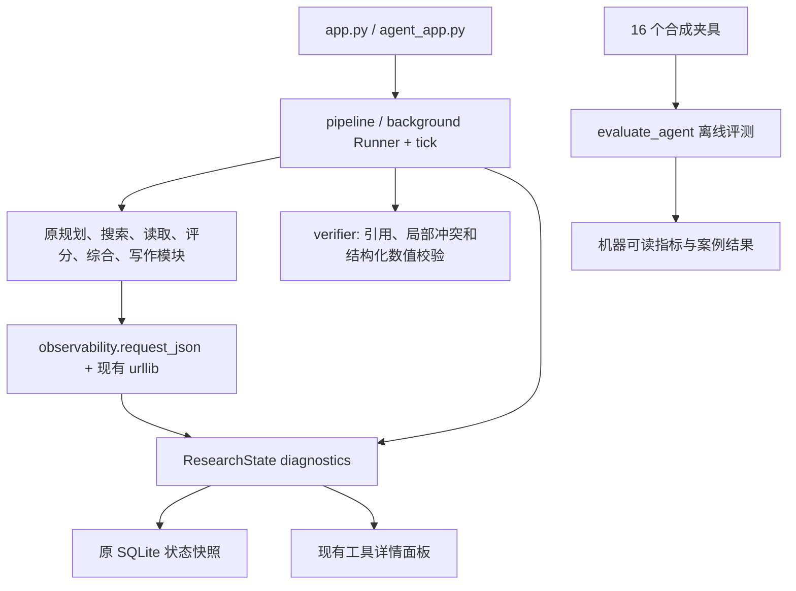

# v2.0 第一阶段：评测与可观测性增量

实施日期：2026-10-12。对象是含用户原有未提交变更的本地工作区。

## 已实现

1. 显式离线回归入口，分别执行 unittest 和旧 main/assert 脚本，拒绝零用例通过。子进程阻断网络、访问项目 data 下的生产 SQLite，并将轨迹标为 offline_fixture。
2. 16 个标准合成夹具：行业、公司、财务、证据冲突各 4 个，固定日期、虚构实体和 example.invalid 来源。记录预期引用校验、覆盖度、数值判断和冲突结果；报告包含数据集 SHA-256。
3. 确定性验证模块：存在的引用 ID、逐字摘录、局部同指标/期间的方向和百分比冲突；结构化数值按实体、指标、期间、币种、单位和单季/累计口径对齐后用 Decimal 比较。不同比较范围返回 unknown。
4. 对话接入校验及原有一次有界修复。Writer 遇到无效/畸形引用不再删编号保留结论，而是拒绝模型输出并回到已有综合内容的格式化降级。Agent 和 pipeline 都对最终报告检查，校验失败保留证据而不交付违规报告。
5. 搜索缺配置、请求失败或无结果不再替换成模拟来源；旧流水线没有保留证据时失败。Synthesizer 不再重新纳入 keep=False 的证据。
6. 统一模型请求元数据和工具跨度：call_id、parent_id、run_id、stage、起止时间、耗时、错误类型、实际可用 usage；ContextVar 隔离并行任务，继续使用现有 urllib 和 Chat Completions。聊天、判断建议、规划/决策/综合/写作及搜索请求接入。
7. Decimal 费用估算：只读显式 JSON 费率，要求 ISO 日期；区分普通输入、缓存输入和输出。缺 usage、缓存细分或费率时费用未知，已知小计与未知调用数分别展示，工具费用未知。
8. Agent 工具详情面板增加轨迹和费用缺失说明；旧报告没有轨迹时不回填推测值。聊天保存结构化验证结果。后台 Agent 接入 Research Health；聚焦计划更新后重新附加证据策略。
9. 后台初始读取和连续保存失败被捕获。无法保存时展示进程内错误，不确认未提交命令；已保存命令重放不会重复调用模型。线程退出按身份清理，不误删正常退出后启动的新线程。
10. 新增 GitHub Actions 离线回归配置；本轮只在本地验证，尚未在 GitHub 执行。

## 结构与兼容性



没有新增生产数据库表或迁移历史数据。新增 trace、trace_summary、verification 都在 diagnostics 中，沿用已有 JSON 序列化和恢复。暂停仍是工具结束后生效，服务重启仍需显式恢复。

有意改变的失败行为：真实搜索不再返回模拟证据，失效引用不再静默移除，全部证据淘汰时不再再次用于综合。这些是真实性修复，不会改写历史报告。

## 验证结果

- 修改前：16 组回归入口全部通过，37 个 unittest。保存为 `artifacts/v2-baseline.json`。
- 新增：34 个测试，涵盖错误引用、相反结论、百分比、期间/单位/币种/口径差异、缓存费用、未知 usage、敏感内容排除、轨迹持久化和线程隔离、暂停恢复、重放去重、反复保存失败、评测失败检测和轨迹界面。
- 新增两个外部 I/O 替身集成测试：实际执行 Planner、Searcher、Reader 的提取、Evaluator、Synthesizer、Writer 和状态管理，分别覆盖 pipeline 和逐步 Agent。仅替换 HTTP/页面获取，不替换业务组件。验证完整报告校验、模型 usage 汇总、策略附加和 Research Health。
- 最终：18 组入口、71 个 unittest 全部通过。保存为 `artifacts/v2-regression.json`。
- 16/16 夹具与预期一致；引用完整性判断和结构化数值判断均在这些夹具上匹配预期，冲突 TP=3、FP=0、FN=0、TN=13，precision/recall=1。它们是小型合成检查集结果，不代表真实研究准确率。
- 16/16 案例的一般语义支持仍为 unknown；没有把“未检测到冲突”计为“证明结论正确”。各案例覆盖度保存在 `artifacts/agent-evaluation.json`。
- Python 编译和 git diff --check 通过；有既有 CRLF 提示和 Streamlit bare-mode 提示，无对应测试失败。

开发时出现的新测试辅助函数参数错误已修正；最终报告只包含最终通过的结果。未调用真实模型、Tavily 或财务 API，没有新增研究调用费用；读取官方文档不属于研究 API 调用。

## 复现

```powershell
.\.venv\Scripts\python.exe -m scripts.run_offline_tests --output artifacts/v2-regression.json
.\.venv\Scripts\python.exe -m scripts.evaluate_agent
.\.venv\Scripts\python.exe -m compileall -q src scripts agent_app.py app.py
```

不用无区别执行所有 test_*.py：现有多个文件仍是联网验收脚本。离线 runner 有显式安全清单，无需配置 API 密钥。

`RESEARCHPILOT_MODEL_PRICING_JSON` 示例（**虚构模型及测试费率，不是真实价格**）：

```json
{
  "fixture-model": {
    "input_per_million": "1",
    "cached_input_per_million": "0.5",
    "output_per_million": "2",
    "as_of": "2026-10-12"
  }
}
```

用户配置生产费率前应核对官方价格。输入 100 Token，其中缓存 40，输出 20，在上述测试费率下模型 Token 费用为 USD 0.00012。没有计入 Tavily、金融数据、其他工具和基础设施费用；usage 未知的失败请求可能仍有费用。

OpenAI usage 字段依据：[官方 Chat Completions 文档](https://developers.openai.com/api/reference/resources/chat/subresources/completions/methods/create)，本轮实际读取了文档中的 prompt_tokens、completion_tokens、total_tokens 和 cached_tokens 定义，没有迁移 Responses API。

## 文件清单

新增：

- `src/observability.py`、`src/verifier.py`、`src/trace_ui.py`
- `scripts/run_offline_tests.py`、`scripts/evaluate_agent.py`、`scripts/test_v2_quality.py`
- `evals/agent_cases.json`
- `.github/workflows/offline-regression.yml`
- `docs/V2_PHASE1.md`
- `artifacts/v2-baseline.json`、`artifacts/v2-regression.json`、`artifacts/agent-evaluation.json`

修改：

- `src/planner.py`、`src/searcher.py`、`src/reader.py`、`src/evaluator.py`、`src/synthesizer.py`、`src/writer.py`
- `src/agent.py`、`src/agent_quality.py`、`src/agent_chat.py`、`src/background.py`、`src/pipeline.py`
- `src/judgments.py`（本轮开始前已经存在于未跟踪工作区）
- `agent_app.py`、`README.md`

未改写 `src/workbench.py`、`src/workbench_ui.py` 和 `src/report_links.py` 的原有用户修改。未新增 Git commit：本轮改动与已有用户改动在部分文件中交叠，且当前权限配置将 `.git` 列为只读；交付保留可审阅的工作区差异，没有将用户原改动混入提交。

## 未完成与限制

- 这次完成第一阶段的基础评测、观测与定向修复，不是完整 v2.0 发布。
- 文本冲突规则只覆盖窄范围，不理解一般因果、行业逻辑、跨公司比较或完整语义蕴含；多指标、多期间、多引用和预期语句通常无法判定。须扩充人工标签与独立 Verifier 才能评估语义支持。
- 反面证据遗漏检查依赖夹具显式 relation=contrary；生产研究尚未自动建立这种关系。
- 后台保存失败提示是进程内诊断；如果数据库完全不可写，不能承诺当前进度已持久化。多 Runner/多进程租约、全面锁冲突和进程崩溃测试仍未完成。
- 原流水线 completed 表示执行链结束；与 Agent 的 grounded findings/partial 标准尚未完全统一。现已阻断无保留证据和报告引用/数值校验失败，但不能把一般语义 unknown 当作验证完成。
- Reader 私网/重定向/下载大小隔离、同 URL 内容变化、公告/财报监控升级尚未完成。
- 财务计算、可追溯财务图表、自动假设生命周期、证据关系图、结构化历史差异和第五阶段技术评估尚未实施。
- 真实 API 连通性、实际模型质量、实账费用和 GitHub CI 均未验收。

下一阶段按现有计划在 stock_data / stock_presentation 之上接入确定性多期财务工具，再用本阶段的评测和轨迹验证研究 Agent 的调用与解释。
